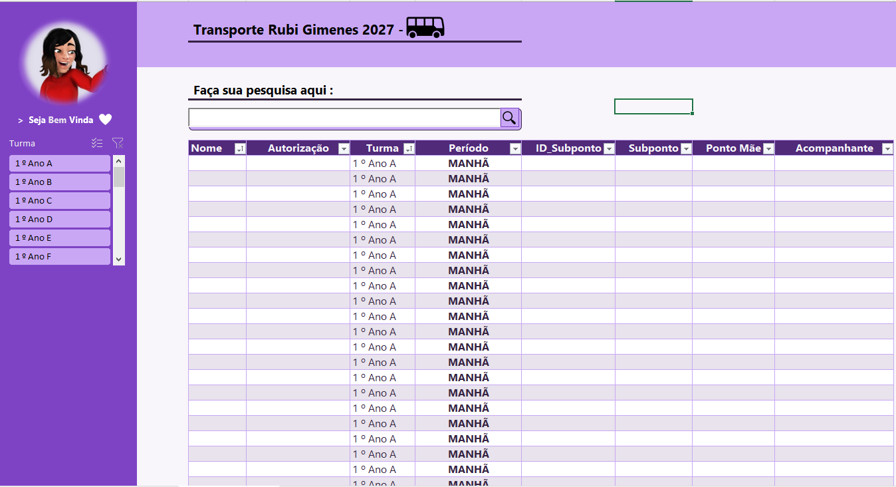
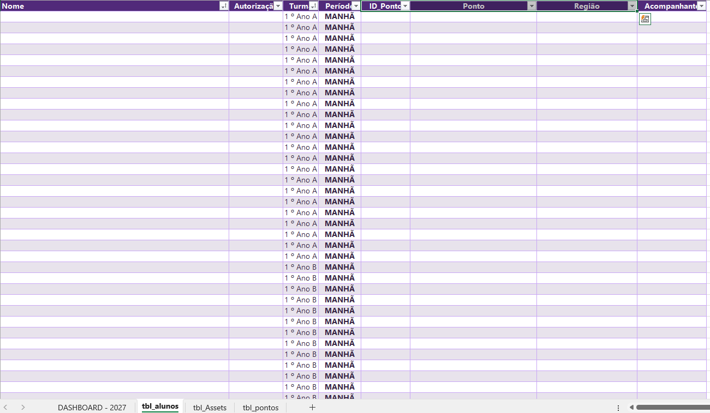
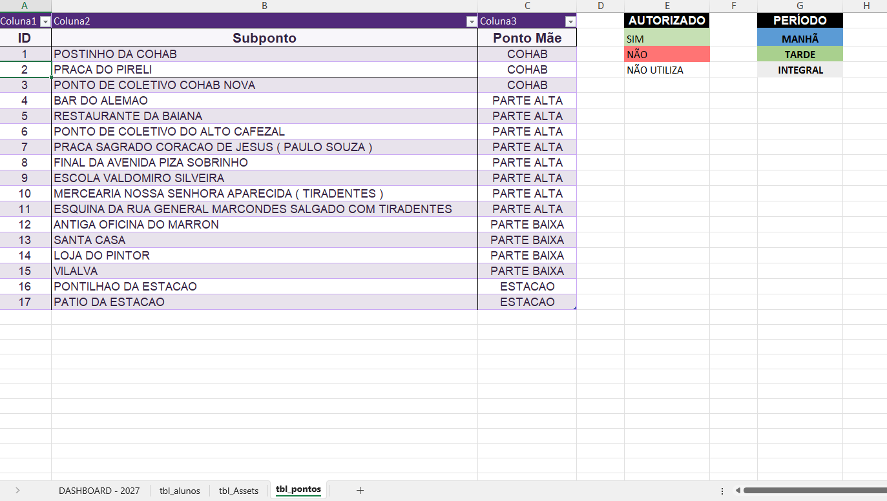
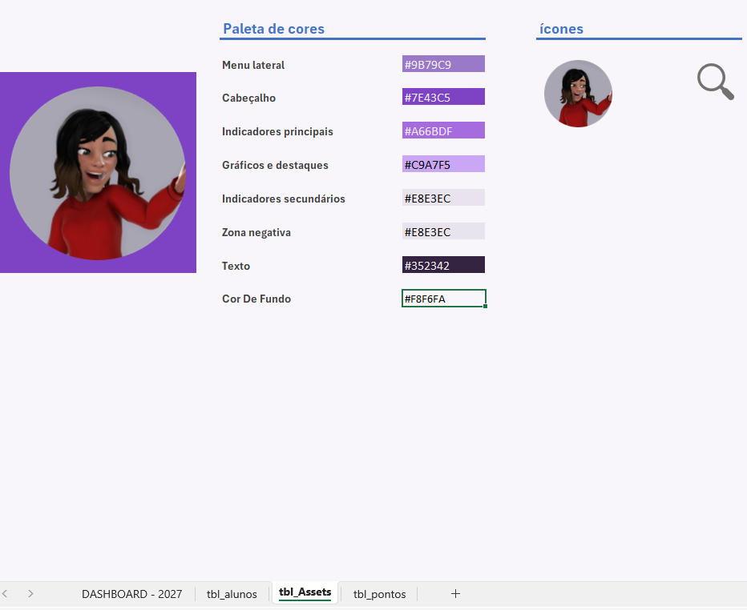

# 🚌 Transporte Rubi Gimenes 2027

### Sistema de Gerenciamento e Organização do Transporte Escolar

Sistema desenvolvido em Microsoft Excel, utilizando VBA, fórmulas e tabelas estruturadas para auxiliar na organização, consulta e gerenciamento das informações relacionadas ao transporte escolar.

---

## 📌 Sobre o projeto

O **Transporte Rubi Gimenes 2027** é uma ferramenta desenvolvida em Microsoft Excel com o objetivo de centralizar e organizar informações dos alunos atendidos pelo transporte escolar.

O projeto foi concebido para facilitar o gerenciamento dos registros, agilizar consultas, padronizar informações dos pontos de embarque e reduzir a necessidade de atividades manuais.

A solução combina uma interface personalizada com recursos de automação, fórmulas de pesquisa e organização estruturada de dados.

## 🖥️ Prévia do sistema

### Dashboard principal

Interface personalizada para consulta e gerenciamento das informações do transporte escolar, contendo menu lateral, filtro de turmas, barra de pesquisa e tabela de registros.

### Base de dados dos alunos

Estrutura responsável pelo armazenamento das informações dos alunos, incluindo identificação, autorização, turma, período, localização do ponto, acompanhante e classificação rural.

### Cadastro de pontos

Tabela auxiliar destinada à organização dos subpontos e seus respectivos pontos principais, permitindo padronizar os locais utilizados no transporte escolar.

### Identidade visual

Organização dos recursos gráficos, imagens e referências de cores utilizados no desenvolvimento da interface.

---

## 🎯 Objetivos

- Centralizar as informações dos alunos.
- Facilitar a consulta de registros por turma e nome.
- Padronizar os cadastros de pontos e subpontos.
- Automatizar a recuperação de informações.
- Identificar alunos vinculados ao transporte da zona rural.
- Facilitar a preparação dos registros para impressão.
- Reduzir tarefas manuais e inconsistências nos dados.

## ⚙️ Funcionalidades

| Funcionalidade | Descrição |
|---|---|
| Dashboard personalizado | Interface desenvolvida com identidade visual própria. |
| Filtro por turma | Permite consultar os alunos de uma turma específica. |
| Pesquisa de alunos | Utiliza VBA para filtrar registros pelo nome da criança. |
| Base estruturada | Centraliza as informações dos alunos. |
| Cadastro de pontos | Organiza os identificadores, subpontos e pontos principais. |
| Preenchimento automático | Utiliza PROCX para recuperar informações relacionadas aos identificadores. |
| Classificação rural | Campo destinado à identificação dos alunos da zona rural. |
| Área de impressão | Organização dos registros para consulta e impressão. |
| Identidade visual | Padronização de cores, imagens e elementos gráficos. |

## 🗂️ Estrutura da pasta de trabalho

O arquivo Excel está organizado nas seguintes planilhas:

| Planilha | Finalidade |
|---|---|
| `DASHBOARD - 2027` | Interface principal de navegação e consulta. |
| `tbl_alunos` | Base principal de informações dos alunos. |
| `tbl_Assets` | Organização dos recursos visuais e da identidade visual. |
| `tbl_pontos` | Cadastro auxiliar de subpontos e pontos principais. |

## 🗄️ Estrutura dos dados

### Base de alunos — `tbl_alunos`

A base principal contempla os seguintes campos:

| Campo | Descrição |
|---|---|
| Nome | Identificação do aluno. |
| Autorização | Situação da autorização para utilização do transporte. |
| Turma | Turma escolar do aluno. |
| Período | Período de estudo. |
| ID_Ponto | Identificador utilizado para localizar o ponto cadastrado. |
| Ponto | Nome do ponto relacionado ao aluno. |
| Região | Região da cidade correspondente ao ponto. |
| Acompanhante | Informação referente à presença de acompanhante. |
| Rural | Classificação destinada aos alunos da zona rural. |

### Cadastro de pontos — `tbl_pontos`

Tabela auxiliar destinada à centralização das informações dos locais utilizados pelo transporte escolar.

Campos de referência:

- **ID:** identificador do registro.
- **Subponto:** identificação do local específico.
- **Ponto Mãe:** identificação do ponto principal relacionado.

## 🛠️ Tecnologias e recursos utilizados

| Tecnologia | Aplicação |
|---|---|
| Microsoft Excel | Desenvolvimento da ferramenta. |
| VBA | Automação da pesquisa de alunos. |
| PROCX | Recuperação de informações por identificadores. |
| Tabelas estruturadas | Organização e gerenciamento dos registros. |
| Filtros | Consulta e segmentação das informações. |
| Validação de dados | Padronização das entradas, conforme os campos configurados. |

## 🎨 Identidade visual

O projeto utiliza uma identidade visual baseada em tonalidades de roxo e lilás, buscando proporcionar uma interface organizada, consistente e de fácil compreensão.

A paleta utiliza as seguintes cores:

| Aplicação | HEX |
|---|---|
| Menu lateral | `#9B79C9` |
| Cabeçalho | `#7E43C5` |
| Indicadores principais | `#A66BDF` |
| Gráficos e destaques | `#C9A7F5` |
| Indicadores secundários | `#E8E3EC` |
| Texto | `#352342` |
| Fundo | `#F8F6FA` |

## 📚 Documentação

A documentação técnica do projeto será disponibilizada na pasta `docs/`, contendo:

- Manual técnico e de utilização.
- Arquitetura do sistema.
- Dicionário de dados.
- Documentação das automações.
- Orientações de utilização e manutenção.

## 🔒 Privacidade e proteção de dados

Este repositório deve conter exclusivamente arquivos demonstrativos e informações fictícias.

Por envolver dados relacionados a crianças e estudantes, informações pessoais, registros operacionais e dados de localização não devem ser publicados.

A versão de demonstração deve ser sanitizada antes de qualquer compartilhamento.

## 🚧 Status do projeto

**Em desenvolvimento e aprimoramento.**

O projeto está em evolução, com melhorias na interface, automações, documentação e organização das bases de dados.

## 👨‍💻 Objetivo de desenvolvimento

Desenvolver uma solução de apoio administrativo utilizando recursos do Microsoft Excel, demonstrando a aplicação prática de organização de dados, automação de processos e desenvolvimento de interfaces personalizadas.

---

**TRANSPORTE RUBI GIMENES 2027**

*Organização, praticidade e eficiência na gestão do transporte escolar.*

